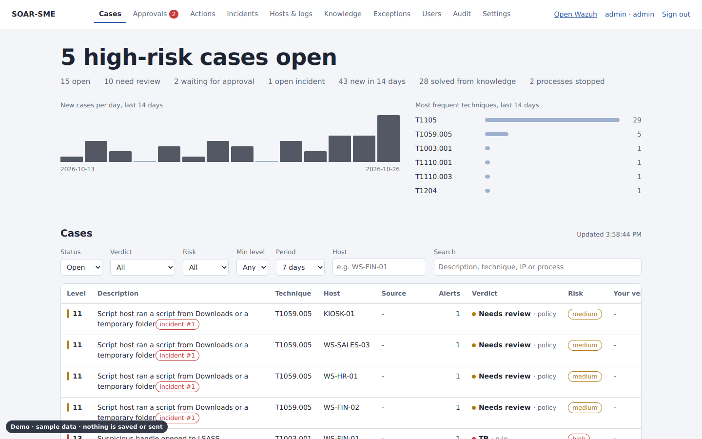
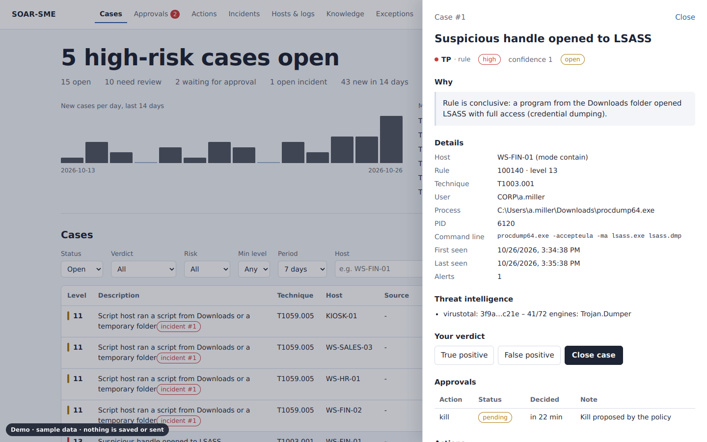
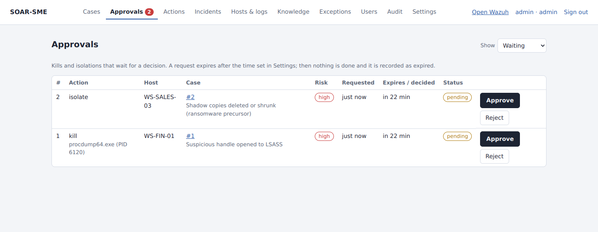
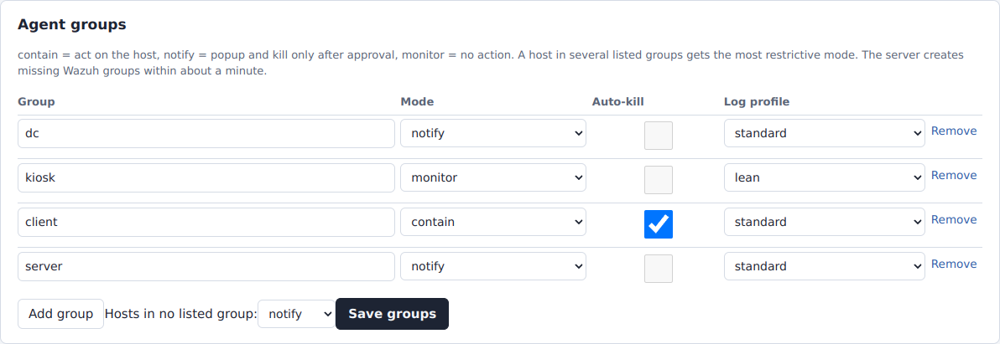
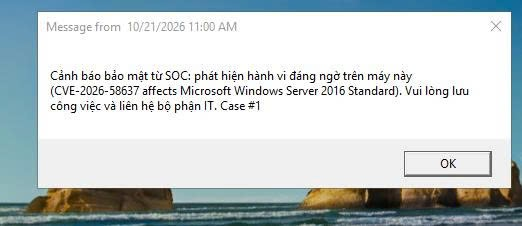

# SOAR-SME

A small security operations center on **one Ubuntu server** for small businesses with Windows endpoints:
**Wazuh 4.x** detects, **n8n** triages (threat intelligence and AI only when you allow it), a **fixed policy**
decides, and the **dashboard** carries the response out on the endpoints — with approvals, limits and an audit trail.

> Version 1.0.0 · up to 300 endpoints on one server · Windows 10/11 and Windows Server 2016+ · MIT licence


## Screenshots

The dashboard with sample data:



| Case detail: reasoning, threat intelligence, approval, manual actions | Approvals: Approve / Reject before a kill or an isolation |
| --- | --- |
|  |  |

| Agent groups: mode, automatic kill, log profile | Warning popup on a Windows endpoint (test lab; the text is set in the users' language) |
| --- | --- |
|  |  |

Try the dashboard without installing anything: download [docs/demo/dashboard-demo.html](docs/demo/dashboard-demo.html) and open it
in a browser (sample data; nothing is saved or sent).

## What it does

- **Detects** Windows and Active Directory attacks with 45 Wazuh rule definitions (detections and helper rules): credential theft (LSASS, Kerberoasting decoy, DCSync),
  ransomware precursors, malicious documents, living-off-the-land binaries, brute force, persistence, defence evasion, Defender failures.
- **Triages** every alert into a case: duplicates merged, earlier verdicts reused, threat intelligence and AI used only in
  **cloud mode** and only on masked data. The default is **local-only**: no case data leaves the server.
- **Responds** on Windows endpoints: popup, Defender scan, light evidence collection, kill (process tree), suspend / resume,
  block an IP, isolate the host. Kills and isolations wait for an **approval** on the dashboard or in **Telegram**, except
  high-fidelity cases in groups where you enable automatic kill (rate-limited).
- **Watches itself**: outbreak incidents (the same behaviour on several hosts), alert-storm digests, silent agents,
  server capacity and lost events.
- **Notifies** Telegram (with Approve / Reject buttons), Microsoft Teams, Slack and Discord (notifications only).
- **Keeps people accountable**: accounts with roles (viewer, analyst, admin), optional two-factor sign-in, an audit log
  of every change, approval and manual action.

## How it works

n8n decides the verdict, the risk and a plan; it never acts. The dashboard backend (the *executor*) applies the safety
limits — pause switch, rate limits, exceptions, approvals — sends the actions through the Wazuh API and records everything.

## Requirements

| Endpoints | CPU | RAM | Disk (90 days of alerts) |
| --- | --- | --- | --- |
| up to 25 (test or small office) | 4 vCPU | 8 GB | 100 GB |
| 26–100 | 8 vCPU | 16 GB | 250 GB |
| 101–300 | 16 vCPU | 32 GB | 1 TB SSD |
| more than 300 | not supported on one server | | |

Ubuntu Server 22.04 or 24.04, Wazuh 4.9.1 to 4.14 (installed for you if missing), Internet access during installation.
Endpoints must reach the server on 1514–1515/tcp (same network or routed subnets; no Internet-only endpoints).
The 101–300 row is an extrapolation of the Wazuh all-in-one guidance (about 100 endpoints on 8 vCPU / 16 GB):
`setup.sh check` and the dashboard warn when the server falls short or Wazuh starts losing events.

## Quick start

```bash
git clone https://github.com/<owner>/soar-sme.git && cd soar-sme
sudo bash setup.sh install        # configuration, Wazuh (if missing), checks, Docker stack, rules, endpoint kit
sudo bash setup.sh n8n            # notification channels and optional keys, workflow
sudo bash setup.sh test-rules     # every rule checked by the real Wazuh engine
sudo bash setup.sh test-notify    # a test message to every channel
```

Then sign in to the dashboard, create the accounts of your team, run `Install-SoarEndpoint.ps1 -Check` on one endpoint
and deploy the kit. Follow **[docs/SETUP.md](docs/SETUP.md)** step by step: it explains every command and its manual equivalent.

## Documentation

| Document | Content |
| --- | --- |
| [docs/SETUP.md](docs/SETUP.md) | Complete installation guide, endpoint deployment, test plan, gradual go-live |
| [docs/CONFIGURATION.md](docs/CONFIGURATION.md) | `soar.conf`, every dashboard setting, secrets, message templates, rules, ports, files |
| [docs/DASHBOARD.md](docs/DASHBOARD.md) | Roles, pages, approvals, manual actions, knowledge, exceptions, accounts |
| [docs/OPERATIONS.md](docs/OPERATIONS.md) | Status, backup and restore, upgrades, retention, accounts from the command line, troubleshooting |
| [docs/TESTING.md](docs/TESTING.md) | What is verified and how, deployment self-tests, field-test checklist |
| [CHANGELOG.md](CHANGELOG.md) | Changes per version |
| [README.vi.md](README.vi.md) | Vietnamese summary of this page |

## Safety first

- Start in **monitor** mode, then **notify**, then approvals, then automatic kill for selected groups only (SETUP.md, step 14).
- Kills and isolations need an approval by default; **isolation is off** until an admin enables it, and it lifts itself.
- Endpoint scripts never stop core Windows processes, Microsoft Defender, Sysmon, the Wazuh agent or common EDR products —
  a program that only *copies the name* of a protected process is recognised as masquerading.
- **Local-only by default.** Cloud mode sends masked case data to the AI and threat-intelligence services you configure:
  check the data-protection rules that apply to you first (for example GDPR, PDPA or PDPL; cross-border transfers often need an assessment).
- The free tiers of Gemini, VirusTotal and AbuseIPDB have terms that may not fit company data or business use.

## Limitations

One server, up to 300 endpoints, no high availability. Response on Windows only. Isolation uses Windows Firewall (an
administrator of the machine can undo it; Group Policy can override it, in which case SOAR-SME refuses to isolate).
Not an EDR: a local administrator can stop or remove the agent (SOAR-SME raises an alert, it cannot prevent it).
Wazuh 4.x only (Wazuh 5 removes the component SOAR-SME uses). Teams, Slack and Discord cannot approve actions.
What is and is not verified on real systems is listed in [docs/TESTING.md](docs/TESTING.md).

## Licence

MIT — see [LICENSE](LICENSE). Wazuh, n8n, Sysmon and the external services keep their own licences and terms.
