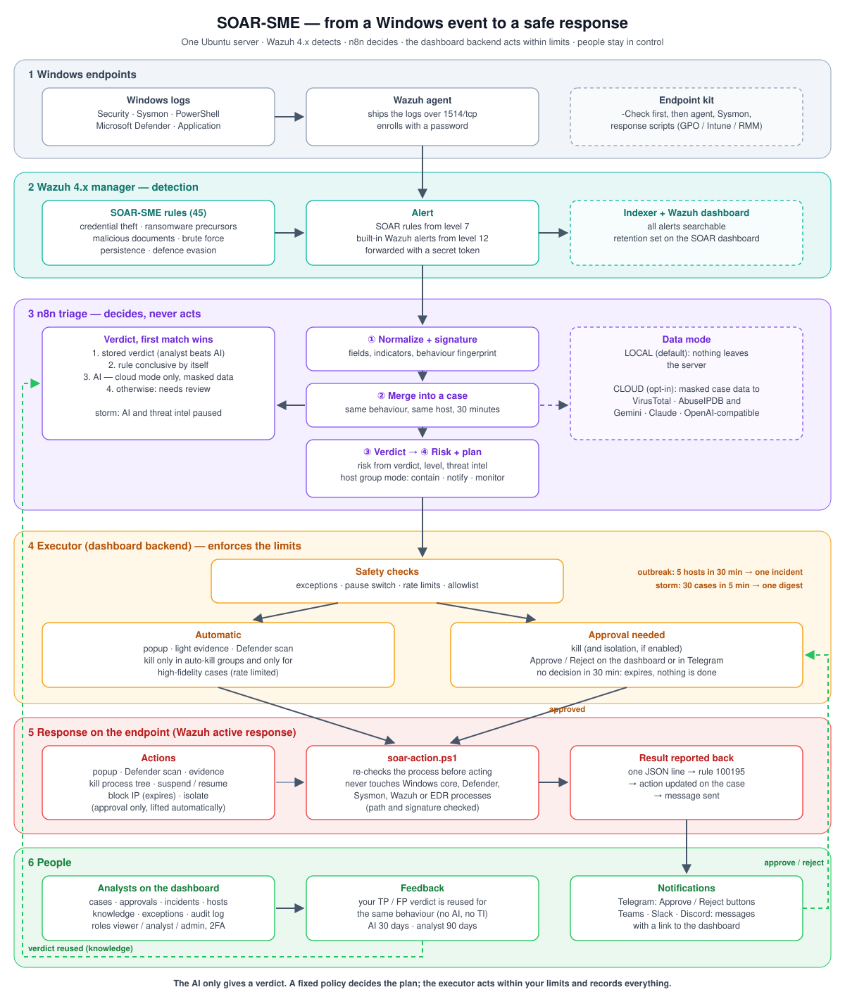

# SOAR-SME (bản tóm tắt tiếng Việt)



> Bản dịch tham khảo. Tài liệu chính thức bằng tiếng Anh: [README.md](README.md) và thư mục [docs/](docs/).

SOAR-SME là trung tâm giám sát an ninh thu nhỏ trên **một máy chủ Ubuntu** cho doanh nghiệp nhỏ dùng Windows:
**Wazuh 4.x** phát hiện, **n8n** phân loại (chỉ dùng AI và threat intelligence khi bạn cho phép), **chính sách cố định**
quyết định, **dashboard** thực thi phản ứng trên máy trạm, có duyệt, giới hạn và nhật ký đầy đủ.

## Chức năng chính
- 45 rule Wazuh: đánh cắp credential, tiền ransomware, tài liệu độc hại, LOLBin, brute force, duy trì truy cập, né tránh phòng thủ.
- Mặc định **chỉ nội bộ**: không dữ liệu case nào rời máy chủ. Chế độ cloud gửi dữ liệu đã che tới AI/TI bạn cấu hình.
- Phản ứng: popup, quét Defender, thu bằng chứng, kill (cả cây tiến trình), tạm dừng, chặn IP, cách ly máy.
  Kill và cách ly **chờ duyệt** trên dashboard hoặc Telegram, trừ ca chắc chắn ở group bật auto-kill (có giới hạn tần suất).
- Sự cố bùng phát, bản tin chống bão alert, cảnh báo quá tải máy chủ và mất event.
- Thông báo Telegram (có nút Duyệt / Từ chối), Teams, Slack, Discord (chỉ thông báo).
- Tài khoản 3 vai trò, xác thực hai lớp tuỳ chọn, nhật ký thao tác.

## Yêu cầu
| Số máy | CPU | RAM | Ổ (90 ngày alert) |
| --- | --- | --- | --- |
| tới 25 (thử nghiệm, văn phòng nhỏ) | 4 vCPU | 8 GB | 100 GB |
| 26–100 | 8 vCPU | 16 GB | 250 GB |
| 101–300 | 16 vCPU | 32 GB | 1 TB SSD |
| trên 300 | không hỗ trợ trên một máy chủ | | |

Ubuntu Server 22.04/24.04, Wazuh 4.9.1–4.14, máy trạm Windows 10/11 và Server 2016 trở lên, cùng mạng nội bộ với máy chủ.

## Cài nhanh
```bash
sudo bash setup.sh install
sudo bash setup.sh n8n
sudo bash setup.sh test-rules
sudo bash setup.sh test-notify
```
Sau đó làm theo [docs/SETUP.md](docs/SETUP.md) (tiếng Anh) từng bước: chạy `Install-SoarEndpoint.ps1 -Check` trên một
máy trước, triển khai bộ cài, tạo tài khoản, chạy kế hoạch kiểm thử, rồi đưa vào vận hành dần
(monitor → notify → duyệt → auto-kill cho group chọn lọc).

## Lưu ý
Một máy chủ, không HA; phản ứng chỉ trên Windows; cách ly dựa trên Windows Firewall (GPO có thể ghi đè, khi đó hệ thống
từ chối cách ly); không phải EDR. Những gì đã và chưa kiểm chứng trên hệ thống thật: [docs/TESTING.md](docs/TESTING.md).
Giấy phép MIT.
